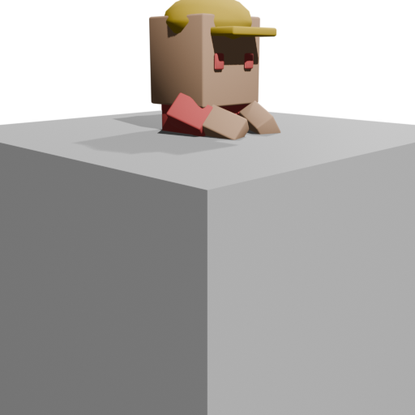
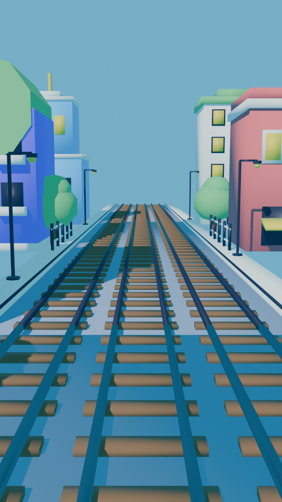
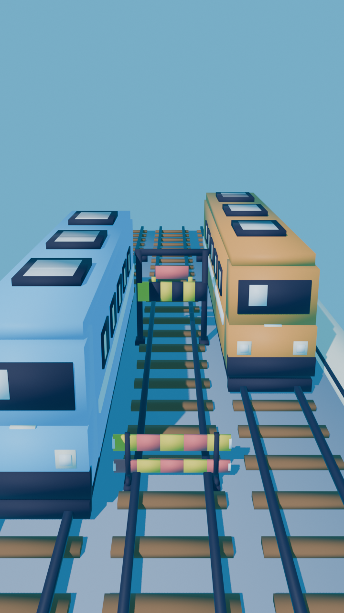
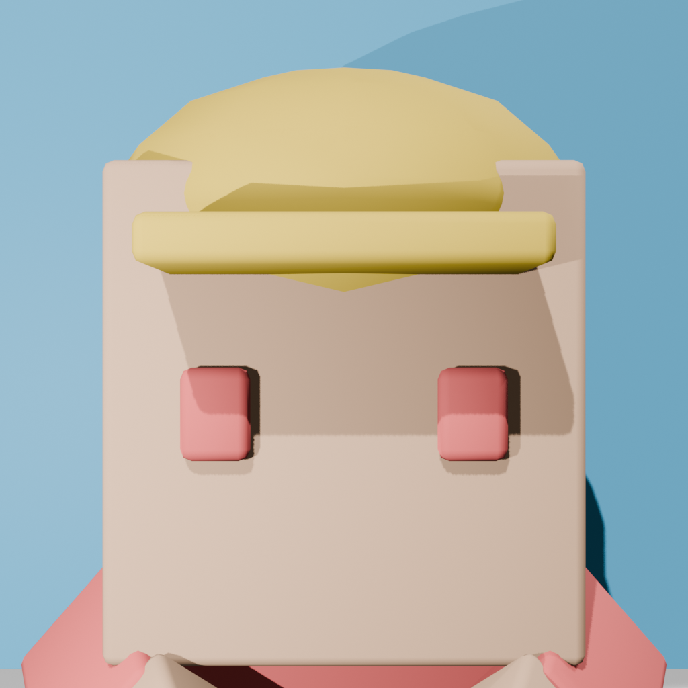

# Metro Blitz

[](https://developer.android.com/about/versions/oreo)
[](https://developer.android.com/about/versions/16)
[](https://kotlinlang.org/)
[](https://github.com/SceneView/sceneview-android)
[](CREDITS.md)

**Metro Blitz** is a high-speed, stylized 3D endless runner for Android built in portrait orientation. Sprint through vibrant urban metro tracks, dodge speeding subway trains, leap over barricades, slide beneath high-voltage overhead beams, and collect gold coins as your speed dynamically ramps up.

Developed natively with **Kotlin**, **Jetpack Compose**, and **SceneView (Google Filament)**.

---

## Highlights & Features

- **Stylized Cartoon Aesthetics:** Handcrafted 3D low-poly models, flat-color materials, saturated palettes, and zero photo textures. Consistent aesthetic inspired by classic cartoon runners.
- **Pure Kotlin Core Architecture:** 100% of the game simulation logic (`Player`, `TrackSystem`, `SpawnDirector`, `CollisionSystem`, `CoinSystem`, `ScoreSystem`) lives in `core/` with zero Android or rendering dependencies—enabling blazing-fast, headless deterministic unit testing.
- **Fairness-Guaranteed Procedural Spawning:** 33 handcrafted obstacle patterns across 3 difficulty tiers. The `SpawnDirector` guarantees at least one safe path through every track row and enforces cooldowns and lane transitions.
- **High-Performance 3D Engine:** SceneView 2.2.1 (Google Filament PBR) with custom lighting, camera shake, distance fog, vertical sky gradient, and strictly **zero per-frame heap allocations** in the hot loop.
- **Dynamic Physics & Controls:** Responsive 3-lane switching (x = -2, 0, +2), physics-based jumping with parabolic gravity, and ducked sliding collision boxes with instant cancellation.
- **Integrated Audio & Haptics:** Custom low-latency procedural sound effects (jump, slide, coin, hit, tap, countdown) via `SoundPool`, looping upbeat background music via `MediaPlayer`, and 120ms tactile feedback pulse on collision.
- **Full State Machine & HUD:** Menu, 3-second countdown, gameplay HUD with real-time score and coins, pause overlay with audio/vibration toggles, and game over dialog with 'NEW BEST!' ribbon.
- **Persistent Data:** High score and total coin bank persisted using Jetpack DataStore Preferences.
- **Production Release Optimized:** Full R8 minification, resource shrinking, Proguard rules preserving Filament/SceneView JNI symbols, and adaptive launcher icons.

---

## Gallery

| Hero Character "Blitz" | Track & City Environment |
| :---: | :---: |
|  |  |

| Procedural Obstacles Lineup | Collectible Gold Coin |
| :---: | :---: |
|  |  |

| App Launcher Icon |
| :---: |
|  |

---

## Architectural Overview

The application follows strict clean-architecture separation across four discrete packages:

```
com.buildstack.metroblitz/
├── core/                # Pure Kotlin game logic (zero Android/Compose/Filament imports)
│   ├── GameConfig.kt         # Single source of truth for speeds, lanes, dimensions
│   ├── GameWorld.kt          # World simulation coordinator & state machine
│   ├── Player.kt             # Player state, jumping, sliding, lane lerp
│   ├── TrackSystem.kt        # Procedural track segment pooling and recycling
│   ├── SpawnDirector.kt      # Fair obstacle row generation & difficulty scaling
│   ├── PatternLibrary.kt     # Curated obstacle patterns across 3 tiers
│   ├── CollisionSystem.kt    # 3D AABB bounding box collision checks
│   ├── CoinSystem.kt         # Coin patterns (lines, arcs, zig-zags) and collection
│   └── ScoreSystem.kt        # Distance integration, coin multipliers, high score
├── render/              # SceneView / Filament 3D scene rendering
│   ├── GameScene.kt          # 3D Viewport, nodes, lighting, camera rig, frame callbacks
│   ├── AssetCatalog.kt       # Asynchronous GLB asset caching and preloading
│   ├── SceneStyle.kt         # Sky gradient, distance fog, directional sunlight
│   └── CameraRig.kt          # Smooth camera follow and impact shake
├── ui/                  # Jetpack Compose UI overlays
│   ├── GameApp.kt            # Root Compose layout and screen orchestration
│   ├── GameViewModel.kt      # ViewModel driving UI StateFlow from GameWorld
│   ├── HudOverlay.kt         # Live score, distance, and coin indicators
│   ├── MenuOverlay.kt        # Title screen, high score, and Start button
│   ├── PauseOverlay.kt       # Resume, Restart, Audio and Vibration toggles
│   ├── CountdownOverlay.kt   # 3-2-1 countdown overlay
│   └── GameOverDialog.kt     # Run stats, 'NEW BEST!' ribbon, and Play Again
├── data/                # Persistence layer
│   ├── ScoreRepository.kt    # Interface for score persistence
│   └── DataStoreScoreRepository.kt # AndroidX DataStore Preferences implementation
└── util/                # System integrations
    ├── SoundManager.kt       # SoundPool SFX and MediaPlayer BGM
    └── HapticHelper.kt       # Android VibratorManager tactile pulse
```

### Architectural Guarantees
- **`PureKotlinCoreTest`:** Enforced by automated test suite—any stray Android, Compose, or Filament import inside `com.buildstack.metroblitz.core` immediately breaks the build.
- **Zero Per-Frame Allocations:** `CoinPool`, `TrackSystem`, and `CollisionSystem` reuse object pools to eliminate GC stutter during the 60 FPS render loop.

---

## Getting Started

### Prerequisites
- **Android SDK:** `compileSdk 36`, `minSdk 26`
- **JDK:** Java 17 toolchain
- **Gradle:** Wrapper included (`gradlew.bat` for Windows, `./gradlew` for macOS/Linux)
- **Blender (Optional):** Version 4.x+ if modifying or re-exporting 3D `.glb` assets via `blender/scripts/`.

### Building from Command Line

Clone the repository and navigate to the project directory:

```powershell
# Build debug APK
.\gradlew.bat assembleDebug

# Build release APK (R8 minified & resource-shrunk)
.\gradlew.bat assembleRelease

# Run all pure Kotlin unit tests
.\gradlew.bat testDebugUnitTest

# Run Android lint
.\gradlew.bat lintDebug

# Run full project verification suite
powershell.exe -File tools\build_test.ps1
```

The compiled release APK is generated at:
```
app/build/outputs/apk/release/app-release.apk
```

---

## Testing & Quality Assurance

The project includes extensive test coverage across the entire feature set:

- **Unit Tests (72+ tests):** Validating game state transitions, physics formulas, track segment pooling, obstacle difficulty curves, pattern library safety invariants, AABB collision boundaries, coin collection radii, and score math.
- **Headless Bot Simulation:** An automated bot plays 2,000 meters in a continuous headless simulation without any collision (`REG-M2`), validating fairness and solvability of generated obstacle patterns.
- **Static Analysis:** Android Lint configured with strict checks.

To execute all unit tests:
```powershell
.\gradlew.bat testDebugUnitTest
```

---

## Asset Pipeline & Credits

- **3D Models:** Procedurally generated in Blender via Python scripts located in `blender/scripts/`:
  - `build_character.py` -> `app/src/main/assets/models/character/blitz.glb`
  - `build_environment.py` -> `app/src/main/assets/models/environment/`
  - `build_obstacles.py` -> `app/src/main/assets/models/obstacles/`
  - `build_coin.py` -> `app/src/main/assets/models/collectibles/coin.glb`
  - `render_icon.py` -> `docs/evidence/phase-8/icon_render.png`
- **Audio:** Custom procedural 16-bit 44.1kHz sound effects and background music generated via `tools/generate_audio.py`. Dedicated to the public domain under [CC0 1.0 Universal](CREDITS.md).

---

## License

This project was built for academic and demonstration purposes. See [CREDITS.md](CREDITS.md) for audio and asset licenses.
